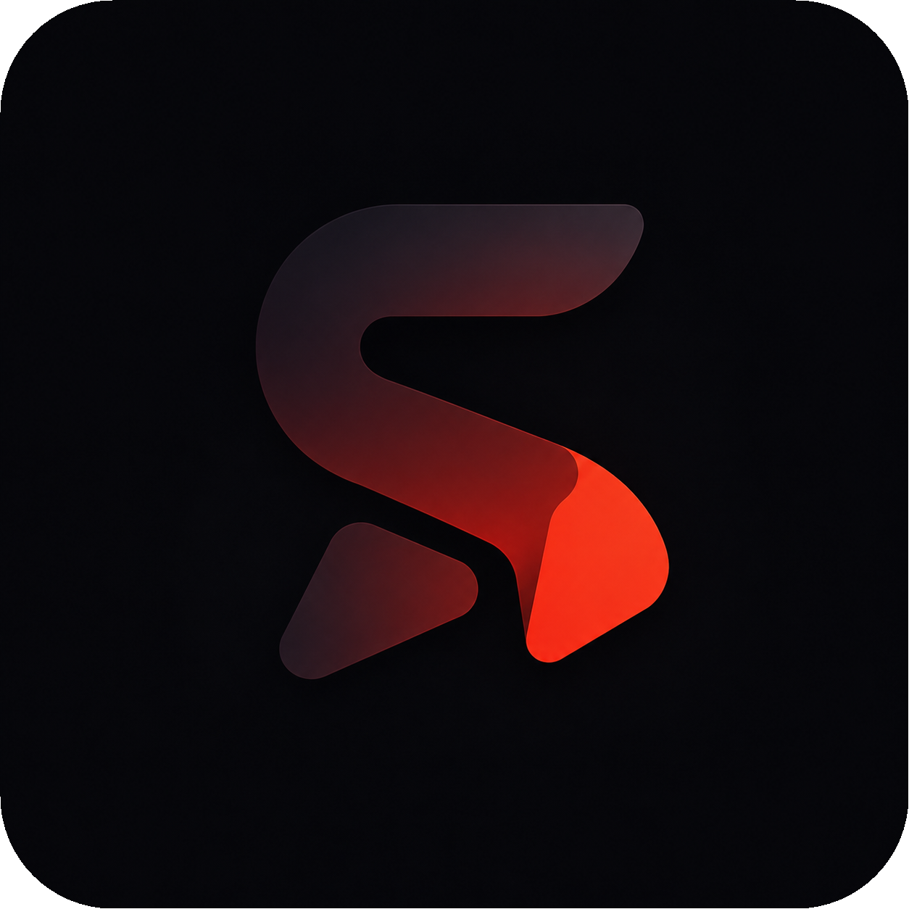
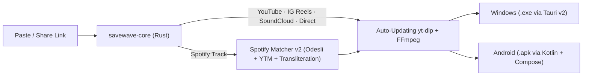

<div align="center">
  

  # SAVEWAVE

  **Paste → Resolve → Save. 100% on your device.**

  No accounts. No servers. No tracking.

  [Download Latest Release](https://github.com/kuberbassi/savewave/releases/latest) · [Website](https://savewave.kuberbassi.com/)

  
  
  
  
  
</div>

---

## How It Works

One shared **Rust core** powers both Windows and Android. No cloud proxies, no backend database — everything runs locally on your machine.



### Supported Sources
| Source | What Works |
| :--- | :--- |
| **YouTube** | Best video + audio, Shorts |
| **Spotify** | Smart Match v2 (handles Cyrillic/CJK/Bollywood/short links/regional URLs) |
| **Instagram Reels** | Public Reels + on-device login modal if IG asks |
| **SoundCloud** | Best audio |
| **Direct Links** | `.mp4`, `.mp3`, `.m4a`, `.png`, `.jpg`, `.webp`, etc. |

---

## v2.0 Rust Rewrite — Measured Gains

| Metric | v1 (Electron + JS + Capacitor) | v2 (Rust + Tauri v2 + Kotlin) | Change |
| :--- | :--- | :--- | :--- |
| **Windows Installer** | `181.0 MB` | **`49.6 MB`** | **-72.6% smaller** |
| **Android `arm64` APK** | `64.8 MB` | **`56.1 MB`** | **-13.5% smaller** |
| **Spotify Match Rate** | `93.3%` | **`100.0%`** | **0 failures** |
| **Spotify Avg / P95 Speed** | `3.67s` / `10.59s` | **`1.62s` / `3.02s`** | **2.3× – 3.5× faster** |
| **`yt-dlp` Updates** | Manual release every time | **Auto-updates every 24h in background** | **Zero maintenance** |

---

## Repo Layout

```text
crates/
  savewave-core/         # Shared Rust brain (source detection, Spotify v2, SSRF guard, updater)
  savewave-android-jni/  # JNI bridge -> libsavewave_core.so
src-tauri/               # Windows desktop app (Tauri v2 -> NSIS .exe)
android/                 # Native Android app (Kotlin + Jetpack Compose -> APK)
public/                  # Desktop UI (React + Tailwind) & website
scripts/                 # Sidecar & Android Rust build scripts
```

---

## Build Locally

```bash
# Rust core tests
cargo test -p savewave-core

# Windows .exe installer (Tauri v2 + bundled yt-dlp & FFmpeg)
npm install
npm run tauri:build

# Android APK (Rust .so + Kotlin Compose)
npm run android:rust
cd android && ./gradlew assembleRelease
```

---

Made by **Kuber Bassi** · [kuberbassi.com](https://kuberbassi.com/) · MIT License
